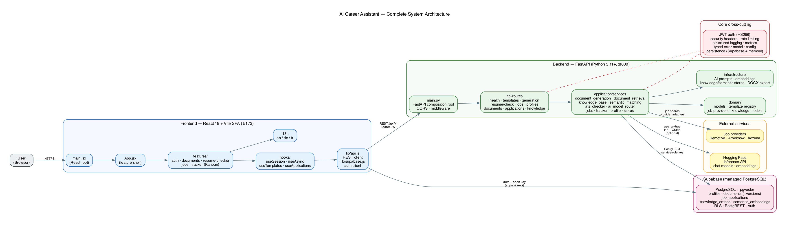
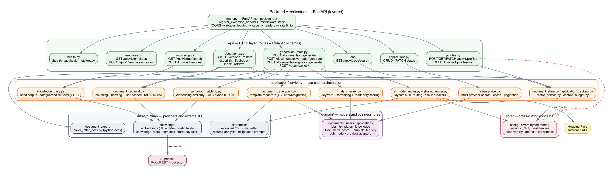
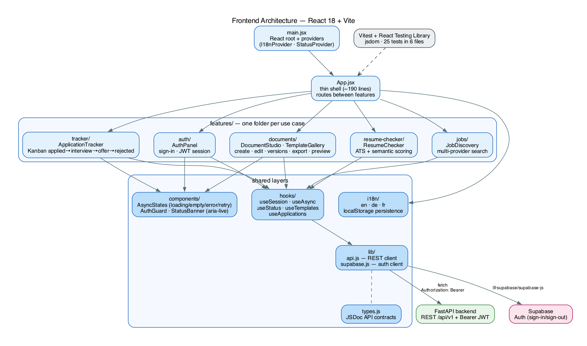
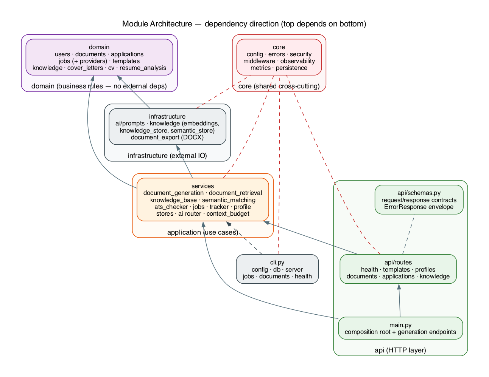

# AI Career Assistant

[](https://www.python.org/)
[](https://nodejs.org/)
[](https://fastapi.tiangolo.com/)
[](https://react.dev/)
[](https://vitejs.dev/)
[](https://supabase.com/)
[](https://huggingface.co/)
[](https://opensource.org/licenses/MIT)
[](https://github.com/astral-sh/ruff)
[](https://github.com/GuyKaptue/ai-career-assistant/actions/workflows/ci.yml)
[](https://github.com/GuyKaptue/ai-career-assistant/releases/)
[](https://github.com/GuyKaptue/ai-career-assistant/commits/main)
[](https://github.com/GuyKaptue/ai-career-assistant/stargazers)
[](https://github.com/GuyKaptue/ai-career-assistant/network)
[](https://github.com/GuyKaptue/ai-career-assistant/issues)
[](./docs/)
[](https://doi.org/10.5281/zenodo.XXXXXX)

> Open-source, self-hostable career platform: AI-assisted CV, cover-letter and
> resignation generation, ATS-style resume analysis, semantic job matching, job
> discovery across multiple providers, and structured application tracking.

**Version:** 0.1.0 · **License:** MIT · **Status:** production-ready backend + frontend, fully tested

AI Career Assistant helps job seekers create tailored career documents, evaluate
them against real job descriptions, discover relevant openings, and track every
application — without relying on closed tools or paid subscription layers. All
AI features degrade gracefully to deterministic, offline-safe fallbacks so the
system keeps working without network access or paid inference credits.



## Features

### Document generation (production-ready)

- **CV, cover-letter, and resignation generation** from structured inputs with
  19 templates (12 CV, 6 cover-letter, 1 resignation), multi-locale support
  (EN/DE/FR), and live template preview
- **Deterministic template path by default** — generation works fully offline;
  an optional `use_ai: true` flag routes through Hugging Face inference behind
  a dynamic model router with typed failure handling, circuit breakers, and
  bounded fallback chains
- **Human-review notice** on every AI-generated document ("AI-generated content —
  review before sending")
- **Document storage with versioning** — every content change snapshots the
  previous version; list, inspect, and restore any version
- **Export to HTML, PDF, and DOCX** with magic-byte-verified output

### Resume analysis (production-ready)

- **ATS-style scoring** (0–100) with keyword overlap, formatting, and readability
  sub-scores plus a transparent explanation
- **Semantic matching** — embedding similarity (384-dim) combined 50/50 with the
  ATS keyword score, with concept-level explainability and an ATS-only fallback
  when embeddings are unavailable

### Job discovery and tracking (production-ready)

- **Multi-provider job search** (Remotive, Arbeitnow, Adzuna) with normalization,
  deduplication, caching, pagination, rate-limit handling, and provider isolation
- **Semantic re-ranking** of results against an optional candidate text
- **Kanban application tracker** (applied → interview → offer → rejected) with
  status history, notes, and follow-up dates

### Retrieval-augmented generation (production-ready)

- **Career knowledge base** — vectorized career guidance (pgvector) retrieved and
  injected as reference-only context into generation
- **Personal document retrieval** — the user's own CVs, cover letters, and resume
  analyses are chunked, embedded, and retrieved (user-scoped, RLS-enforced) to
  personalize generation, under a hard context budget

### Security and operations

- HS256 JWT authentication (32+ byte secret), cross-user isolation (404 on
  foreign resources), Supabase Row-Level Security, security headers, per-IP rate
  limiting, structured JSON logging with correlation ids, centralized typed error
  model, GDPR erasure endpoints

## Technology stack

| Category | Technology |
|----------|------------|
| Backend | Python 3.11+, FastAPI, Pydantic v2, Uvicorn |
| Frontend | React 18, Vite 5, Testing Library, Vitest |
| Database | Supabase (PostgreSQL + pgvector), RLS |
| AI/ML | Hugging Face Inference API (chat models; `sentence-transformers/all-MiniLM-L6-v2` embeddings), deterministic feature-hashing fallbacks |
| Job providers | Remotive, Arbeitnow, Adzuna (HTTP adapters) |
| Export | ReportLab (PDF), python-docx (DOCX), HTML |
| Auth | PyJWT (HS256 legacy + ES256/RS256 via Supabase JWKS), Supabase JWT claims |
| QA | pytest, Vitest, ruff, mypy, bandit, pip-audit, gitleaks |
| Deployment | Docker Compose, GitHub Actions CI |

## Architecture

The backend is a layered FastAPI application; the frontend is a React SPA that
talks to the backend API (and optionally to Supabase directly for auth).







**Communication paths:**

1. Browser → React SPA (Vite dev server or static build)
2. SPA → FastAPI REST API (`/api/v1/...`) with Bearer JWT
3. FastAPI → Supabase (PostgREST + pgvector) for persistence and vector search
4. FastAPI → Hugging Face Inference API (only when `use_ai: true` or embeddings
   are remote; otherwise deterministic local fallbacks)
5. FastAPI → job provider APIs (Remotive / Arbeitnow / Adzuna) for job search

## Installation

### Prerequisites

- Python 3.11+ (3.13 recommended)
- Node.js 20+
- A Supabase project (free tier works) — or run without persistence for offline use
- Optional: `HF_TOKEN` for remote AI inference and embeddings

### 1. Clone and configure

```bash
git clone https://github.com/GuyKaptue/ai-career-assistant.git
cd ai-career-assistant
cp .env.example .env
```

Edit `.env` (never commit it). Required variables:

| Variable | Purpose |
|----------|---------|
| `SUPABASE_URL` | Supabase project URL |
| `SUPABASE_ANON_KEY` | public anon key (frontend) |
| `SUPABASE_SERVICE_ROLE_KEY` | service-role key (backend only) |
| `SUPABASE_JWT_SECRET` | HS256 signing secret, 32+ characters |
| `SUPABASE_DB_URL` | direct Postgres URL for migrations |
| `HF_TOKEN` | Hugging Face token (optional; enables remote inference) |
| `ADZUNA_APP_ID` / `ADZUNA_APP_KEY` | Adzuna provider (optional) |

### 2. Database

Apply the migrations with the Supabase CLI:

```bash
supabase db push   # or: make db-migrate
supabase db status # or: make db-status
```

Migrations live in `supabase/migrations/` (schema, document versioning,
knowledge base, semantic embeddings, personal document retrieval).

### 3. Backend

```bash
cd backend
python3 -m venv .venv
source .venv/bin/activate
pip install -r requirements.txt
uvicorn app.main:app --reload --host 127.0.0.1 --port 8000
```

The backend must run from the `backend/` directory (absolute `app.*` imports).

### 4. Frontend

```bash
cd frontend
npm install
npm run dev -- --host 127.0.0.1 --port 5173
```

### 5. Docker (alternative)

```bash
docker compose up --build
```

Starts the backend on `:8000` and the frontend on `:5173`. Docker Desktop or a
compatible engine is required; use the manual steps above when Docker is
unavailable.

## Usage

### Web UI

Open <http://localhost:5173>. The app provides: sign-in, template gallery with
live preview, document studio (create/edit/version/export), resume checker, job
discovery, and the Kanban application tracker.

### CLI

```bash
ai-career-assistant config validate     # validate runtime configuration
ai-career-assistant db status           # migration status (Supabase CLI)
ai-career-assistant server              # start the API server (127.0.0.1:8000)
ai-career-assistant jobs search "data scientist" --location "Berlin" --limit 5
ai-career-assistant documents list --token "<JWT>"
ai-career-assistant health              # health check against the API
```

### API examples

```bash
# Health
curl http://localhost:8000/api/ready

# Generate a CV (deterministic template path — no AI token needed)
curl -X POST http://localhost:8000/api/v1/documents/cv/generate \
  -H "Content-Type: application/json" \
  -d '{"name": "Jane Doe", "target_role": "Data Scientist",
       "summary": "5 years in ML engineering", "skills": ["Python", "PyTorch"]}'

# ATS resume check (lexical + semantic scoring)
curl -X POST http://localhost:8000/api/v1/resume/check \
  -H "Content-Type: application/json" \
  -d '{"resume_text": "...", "job_description": "..."}'

# Job search
curl "http://localhost:8000/api/v1/jobs/search?query=data+scientist&limit=5"

# Authenticated endpoints (profiles, documents, applications, knowledge)
curl http://localhost:8000/api/v1/documents -H "Authorization: Bearer <JWT>"
```

Full API documentation is served at `http://localhost:8000/docs` (OpenAPI/Swagger).

## Project structure

```
ai-career-assistant/
├── backend/                  # FastAPI application (Python)
│   ├── app/
│   │   ├── api/              # HTTP layer: routes + Pydantic schemas
│   │   ├── application/      # use-case orchestration (services)
│   │   ├── domain/           # domain models, registries, provider adapters
│   │   ├── infrastructure/   # AI prompts, knowledge stores, DOCX export
│   │   ├── core/             # config, errors, security, middleware, persistence
│   │   ├── cli.py            # real CLI (config/db/server/jobs/documents/health)
│   │   └── main.py           # FastAPI composition root
│   ├── tests/                # unit / integration / api / security / contract
│   └── pyproject.toml        # packaging + tool config (ruff, mypy, pytest)
├── frontend/                 # React 18 + Vite SPA
│   └── src/
│       ├── features/         # auth, documents, resume-checker, jobs, tracker
│       ├── components/       # AsyncStates, AuthGuard, StatusBanner
│       ├── hooks/            # useSession, useAsync, useStatus, useTemplates, ...
│       ├── lib/              # api client, supabase client
│       └── i18n/             # en / de / fr
├── supabase/migrations/      # SQL migrations (schema → RAG tables)
├── docker/                   # Dockerfile.backend, Dockerfile.frontend
├── docs/                     # architecture, requirements, privacy, academic, ...
│   ├── diagrams/             # editable Graphviz sources
│   └── images/               # rendered architecture diagrams (PNG)
├── .github/workflows/ci.yml  # CI: lint, typecheck, tests, security gates
├── docker-compose.yml
├── Makefile                  # install/test/lint/typecheck/db/docker targets
├── .env.example              # configuration template (no secrets)
├── pyproject metadata        # backend/pyproject.toml (PEP 621)
├── CITATION.cff
└── LICENSE (MIT)
```

## Testing and quality assurance

```bash
make test            # backend: pytest (unit, integration, API, security, contract)
make test-unit       # backend unit tests only
make test-api        # API tests only
make test-security   # security tests + bandit
make coverage        # pytest with coverage report
make lint            # ruff check
make format-check    # ruff format --check
make typecheck       # mypy
make frontend-build  # frontend production build
```

Frontend:

```bash
cd frontend
npm test             # Vitest + React Testing Library (jsdom)
npm run build        # production build
```

Current status: **backend 404 passed / 1 skipped**, **frontend 144 passed**,
`ruff`/`mypy`/`bandit` clean, coverage ≈ 77% (network and live-DB paths are
covered by live integration tests, not unit tests, by design).

## Security and configuration

- **Authentication:** HS256 JWTs issued by Supabase; the backend validates the
  signature and derives identity from the `sub` claim — never from request bodies.
  Tokens with a signing secret shorter than 32 bytes are rejected (503).
- **Authorization:** every user-scoped route filters by JWT `sub`; foreign
  resources return 404 (not 403) to avoid leaking existence. Supabase RLS
  enforces ownership at the database layer as a second boundary.
- **Secrets:** all configuration comes from environment variables; `.env` is
  git-ignored. Never commit `SUPABASE_SERVICE_ROLE_KEY`, `SUPABASE_JWT_SECRET`,
  or `HF_TOKEN`. CI runs gitleaks, bandit, and pip-audit on every push.
- **AI privacy:** with `use_ai: false` (the default) no user data leaves the
  instance. With `use_ai: true`, only the generation prompt is sent to Hugging
  Face. See `docs/privacy/data-flow.md` for the full transmission table.
- **Error handling:** a centralized typed error model returns
  `{detail, category}` envelopes; stack traces and internal details are logged
  server-side and never returned to clients.

## Development and contribution

Contributions are welcome. Conventions:

- Layered architecture: `api` (HTTP) → `application` (use cases) → `domain`
  (models) → `infrastructure` (providers); `core` holds cross-cutting concerns.
- Every feature ships with tests; every user-scoped endpoint has cross-user (404)
  tests; every migration has contract tests.
- Run `make format-check lint typecheck test` before submitting.
- New third-party assets must be permissively licensed and recorded in
  `docs/templates/third-party-assets.md` and `LICENSES.md`.
- See `CONTRIBUTING.md` for the full workflow.

## Documentation

- `docs/` — documentation index
- `docs/architecture/` — architecture decisions and system design
- `docs/requirements/` — requirements, traceability matrix, implementation roadmap
- `docs/privacy/data-flow.md` — data flow, AI transmission table, GDPR rights
- `docs/academic/` — system, mathematical, ATS, and evaluation methodology
- `docs/templates/` — template catalog and rendering architecture
- `docs/images/` — rendered architecture diagrams (PNG)
- `docs/diagrams/` — editable Graphviz sources for every diagram
- API reference: `http://localhost:8000/docs` (OpenAPI)

## Author

- **Guy M. Kaptue T.**
- Email: guykaptue24@gmail.com
- GitHub: <https://github.com/GuyKaptue>

Released under the [MIT License](LICENSE).
